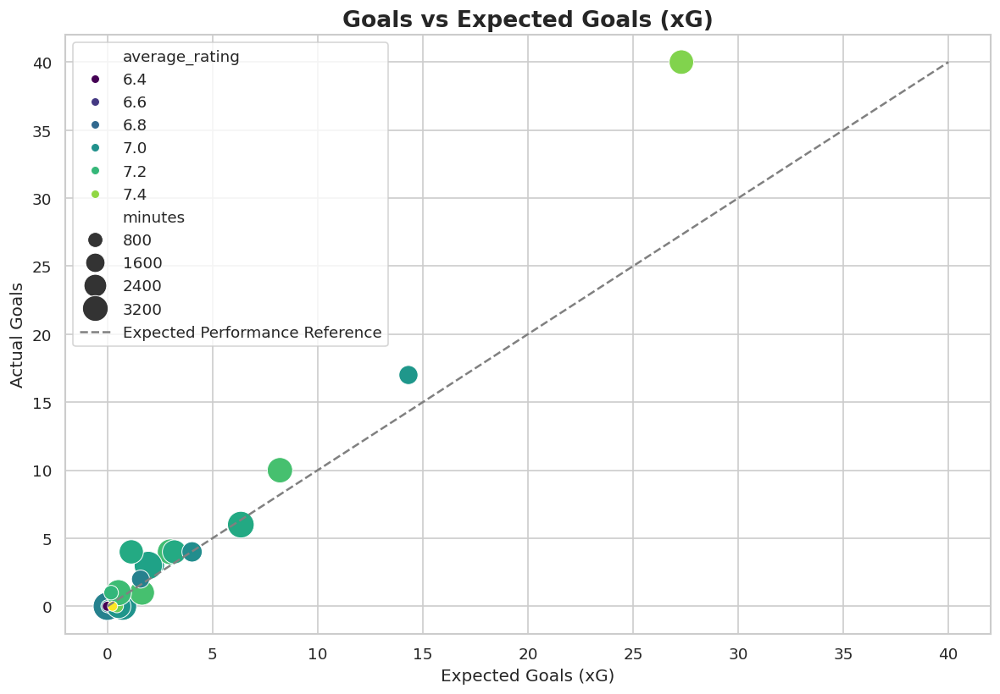
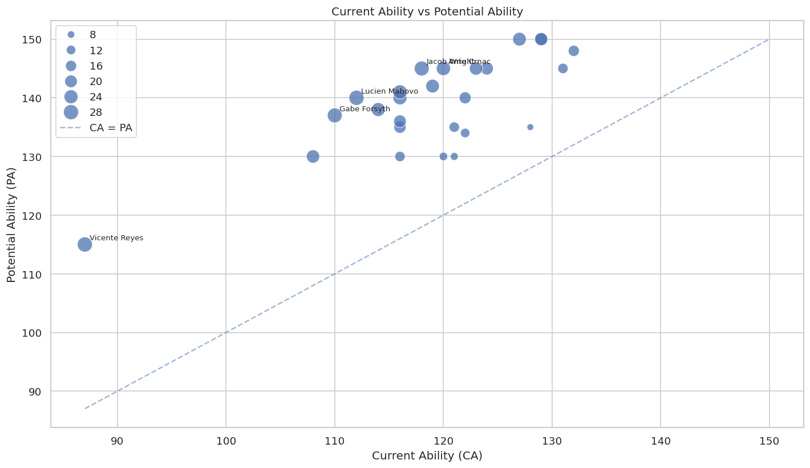
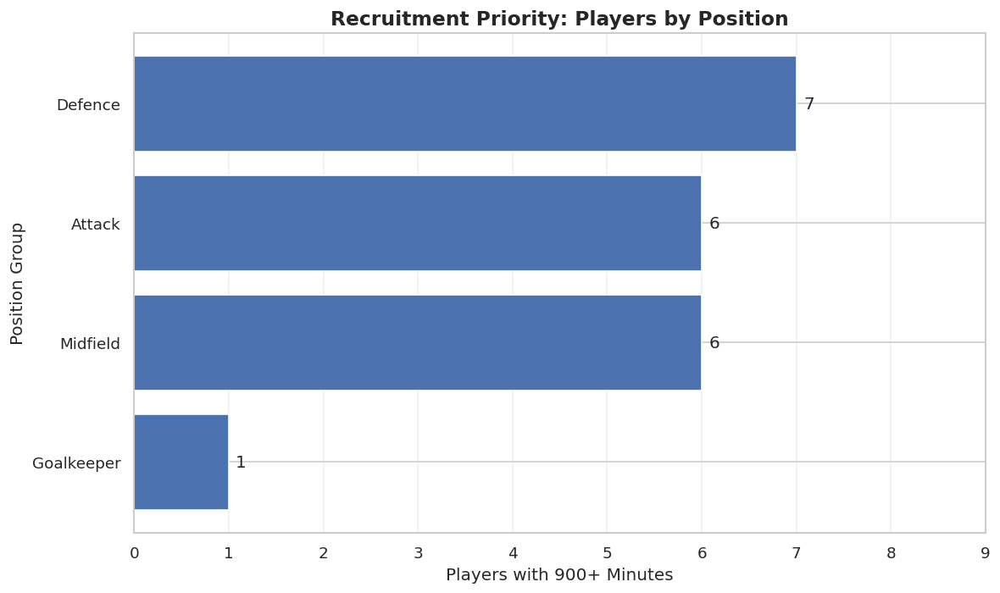

# Norwich City — Football Analytics & Recruitment Analysis

## Project Overview

This project explores football analytics through a Football Manager 2027 save, using Norwich City as a case study.

The objective is to transform in-game player and squad data into meaningful insights through data analysis, performance evaluation, squad profiling, and recruitment assessment.

The project demonstrates how Python and data analytics techniques can support football-related decision-making.

## Objectives

- Analyze individual player performance and contribution.
- Identify key performers using statistical metrics.
- Evaluate squad age distribution and player development potential.
- Examine positional depth and squad structure.
- Identify potential recruitment priorities and development opportunities.

## Tools & Technologies

- Python
- Google Colab
- Pandas
- NumPy
- Matplotlib
- Seaborn

## Project Structure

The analysis is organized into six sections:

1. **Data Loading & Preparation** — Data cleaning, merging, and preparation.
2. **Exploratory Data Analysis (EDA)** — Initial exploration of player and squad performance.
3. **Player Performance Analysis** — Individual performance metrics, attacking contributions, and efficiency.
4. **Squad Analysis** — Age distribution, Current Ability, Potential Ability, positions, and contracts.
5. **Recruitment & Scouting Analysis** — High-performing assets, development candidates, and recruitment priorities.
6. **Conclusion & Recommendations** — Summary of findings and strategic recommendations.

## Key Findings

### Player Performance

- Mohamed Touré recorded 43 goal contributions (40 goals and 3 assists).
- He achieved the highest average rating among players with at least 900 minutes: 7.37.
- Ruairi McConville was the most utilized player, recording 3,961 minutes.

### Squad Profile

- 26 players were included in the performance analysis.
- Average squad age: 24.73 years.
- Average Current Ability: 119.12.
- Average Potential Ability: 138.88.
- 16 players had a development gap of at least 20 points.

### Recruitment Insights

- Goalkeeper succession was identified as an area for further investigation.
- Midfield succession planning was highlighted due to the age of experienced players.
- Young players such as Oscar Schwartau, Kellen Fisher, and Lucien Mahovo showed interesting development profiles.
- Mohamed Touré emerged as a key attacking asset.

## Visual Highlights

### 1. Goals vs Expected Goals

### 2. Player Performance Comparison

### 3. Current Ability vs Potential Ability

### 4. Recruitment Priority Analysis

## Methodology

The project uses several analytical approaches:

- Data cleaning and merging using Pandas.
- Descriptive statistics.
- Ranking and comparison of player performance.
- Per-90-minute performance metrics.
- Goals versus expected goals analysis.
- Current Ability versus Potential Ability comparison.
- Positional grouping and squad profiling.
- Recruitment screening based on performance, age, ability, estimated transfer value, and wages.

A minimum playing-time threshold of 900 minutes was used for most player performance comparisons.

## Limitations

- The dataset is sourced from a Football Manager 2027 save, not official real-world football data.
- The performance analysis covers 26 players with available performance records, rather than the entire 82-player squad profile dataset.
- Potential Ability represents an in-game potential estimate and does not guarantee future development.
- Transfer values and wages are in-game data, not real-world market valuations.
- Playing-time thresholds may exclude players with limited opportunities.

## Project Status

Completed — Initial Football Analytics Case Study.

Future improvements may include tactical analysis, player role evaluation, recruitment comparisons, and more advanced performance metrics.

## Disclaimer

This project is an independent analytical exercise based on Football Manager 2027 data. It is intended for educational and portfolio purposes only.
